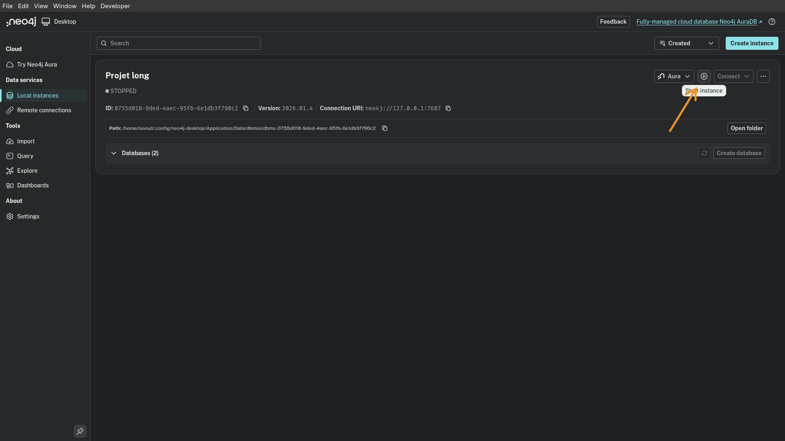

# Étude comparative de performance entre Cypher 25 et SQL

## ▶ À quel problème répond-il ?

Le projet s'attaque à l'évolution des langages de requête de graphes,
particulièrement avec l'arrivée de la norme ISO GQL qui influence
**Cypher 25**. Le problème central est de déterminer si les nouvelles
fonctionnalités de Cypher 25 (comme les Quantified Graph Patterns ou
l'opérateur allReduce) résolvent efficacement les limitations syntaxiques
et les problèmes de performance identifiés dans **Cypher 5**. Il s'agit
principalement de situer ces performances par rapport au modèle relationnel
standard (**SQL/PostgreSQL**).

## ▶ Quels sont les objectifs ?

### Objectif Principal

L'objectif de ce projet de recherche ici est de comparer les performances et
les limites des bases de données relationnelles (**PostgreSQL**) face aux bases
de données orientée graphes (**Cypher 25 (Neo4J)**).

### Objectifs Intermédiaires

- **Génération de graphe** : Génération d'un graphe aléatoire répondant à
  la problématique du sac à dos comme données de recherche.

- **Benchmark de Performance** : Comparer les temps d'exécution et les plans
  d'exécution (EXPLAIN/PROFILE) entre SQL et Cypher 25 sur des
  tâches spécifiques (chemins croissants, récursivité).

## ▶ Installation

Pour installer le projet, commencez par cloner le projet :
```bash
git clone https://moule.informatique.univ-paris-diderot.fr/pan/jin-pan-pprog-2025.git
```

## ▶ Executer le projet

### Installer Neo4J et PostgreSQL

Pour l'installation de Neo4J Desktop, nous vous invitons à suivre les étapes
décrite sur le site officielle juste ici [neo4j.com](https://neo4j.com/docs/desktop/current/installation/).

Pour l'installation de PostgreSQL, nous vous invitons à suivre les étapes
décrite sur le site officielle juste ici [postgresql.org](https://www.postgresql.org/download/)

### Initialisser l'environnement dans la racine

```bash
cd ./path/to/jin-pan-pprog-2025/
touch .env
```

Dans ce fichier dotenv, y ajouter les informations suivantes :

```.env
NEO4J_URI=bolt://localhost:7687
NEO4J_USER=neo4j
NEO4J_PASSWORD=password

PG_HOST=localhost
PG_PORT=5432
PG_DB=postgres
PG_USER=postgres
PG_PASSWORD=password
```

Avec ces valeurs à modifier selon votre initialisation de Neo4J et PostgreSQL.

### Lancer le projet

Pour lancer le projet, il faut avoir démarrer Neo4J desktop avec l'application,
ainsi qu'avoir démarrer une instance locale. 

Ensuite il faut installer les dépendances :

```bash
# Ou la façon dont vous installez des packages python.
pip install -r requirements.txt
```

Il ne reste plus qu'à lancer le projet avec :

```bash
cd src
python main.py
```

## ▶ Testabilité : Comment valider le projet ?

### Protocole de test

1. **Validation de l'équivalence** : Vérifier que les requêtes SQL et Cypher
  25 retournent des résultats identiques sur un même sous-ensemble de données.

2. **Comparaison de vitesse d'execution** : Execution l'un après l'autre de
  l'algorithme de recherche des deux types de bases de données et comparer
  la vitesse.

3. **Stress Test** : Identifier le point de rupture où l'évaluation ne termine
  plus sur le jeu de données complet et comparer la résistance de chaque
  moteur.

## ▶ Originalité du projet

Contrairement à une simple utilisation de base de données, ce projet se situe
à la pointe de l'actualité des bases de données en testant des fonctionnalités
de **Cypher 25** qui implémentent les nouveaux standards internationaux (GQL).
L'aspect critique sur les "requêtes problématiques" apporte une dimension de
recherche en ingénierie logicielle.

## ▶ Pourquoi ce n’est pas qu’un collage d’API ?

Le projet nécessite une compréhension profonde de la théorie des graphes
et de l'optimisation de requêtes. Il impose :

- La définition de **contraintes d'intégrité** et de stratégies d'indexation
  spécifiques à chaque modèle.

- Une réflexion sur l'**expressivité des langages** (ex: transformer une
  logique de filtre négatif `NOT EXISTS` en une réduction `allReduce`).

- L'interprétation technique des choix des optimiseurs de requêtes de Neo4j
  et PostgreSQL.

## ▶ Calendrier / Jalons

- **Janvier** : Lecture, compréhension et collecte des travaux des différents binômes.

- **Février** : Synthétiser les travaux des M2 et piste d'approfondissement des recherches.

- **Mars-Avril** : Approfondissement des tests de performance 

- **Avril-Mai** :Rédaction du rapport final d'analyse comparative.

